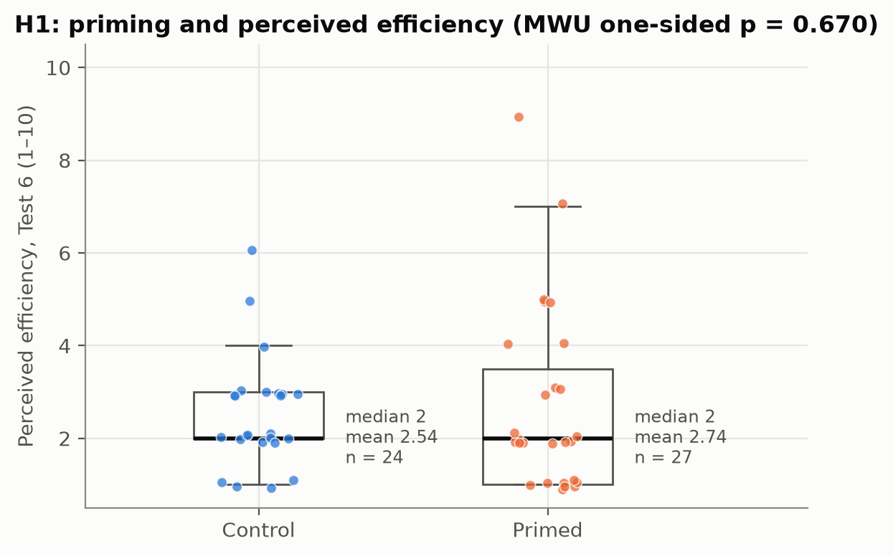
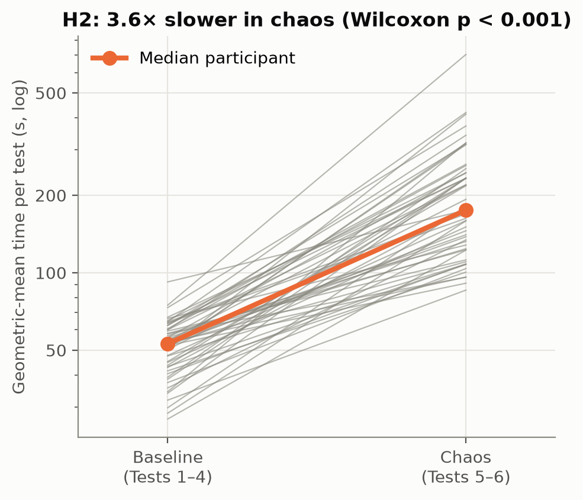
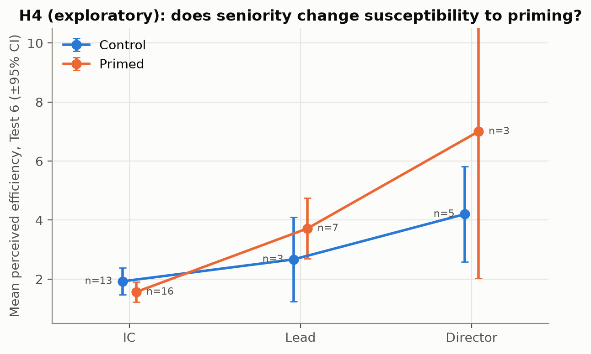
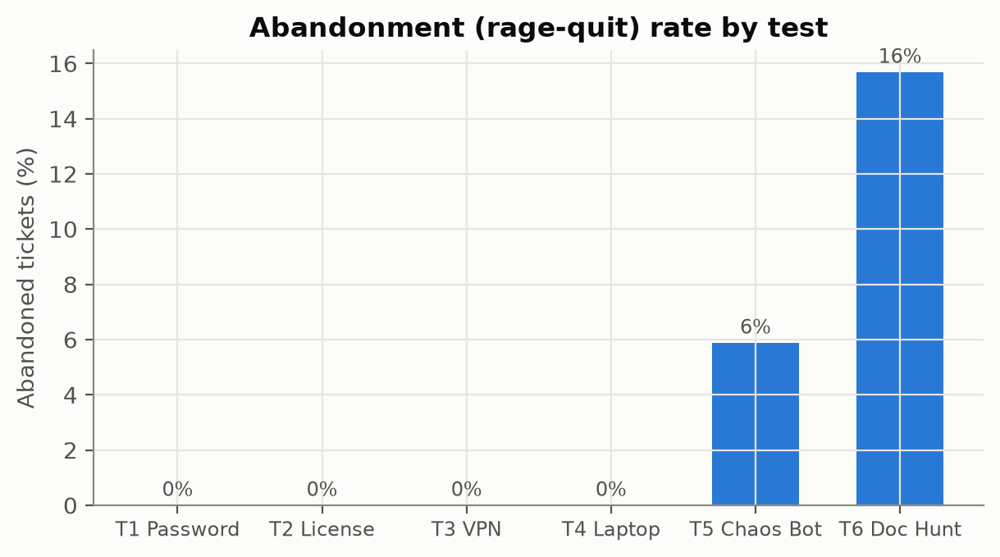

<!-- GENERATED by scripts/build_report.py from report/report_template.md. Edit the template, not this file. -->

# Selling the Single Pane of Glass: Does a One-Line Efficiency Claim Change How People Rate a Broken Ticketing Workflow?

**Authors:** [Your name] & [Partner name] · Module Project 2: Statistical Analysis · October 24, 2026

> ⚠️ **These results come from a SIMULATED pilot dataset** (`data/raw/simulated_pilot_raw.csv`), generated to build and test the analysis pipeline before real participants were run. They are not empirical findings. Rerun `python scripts/run_pipeline.py --raw data/raw/live_sessions.csv` after data collection to regenerate this report from real data.

---

## 1. Abstract

Enterprise software is often judged by how efficient its users *say* it is, and those judgments are made in an environment full of vendor messaging. We built a six-task IT-ticketing simulator and ran a randomised between-subjects experiment. Before two deliberately frustrating tasks (a malfunctioning AI assistant and a "documentation hunt" with a hidden submit button), half of participants saw a one-sentence efficiency claim: *"ServiceNow's single pane of glass is incredibly efficient."* The other half saw no banner. Our primary hypothesis (H1) was that the claim would raise perceived-efficiency ratings on the documentation-hunt task. With 51 analysable participants (27 primed, 24 control), we found no evidence that the claim raised efficiency ratings (Mann–Whitney one-sided p = 0.670; rank-biserial r = -0.07, 95% CI [-0.37, 0.24]). Ratings were bunched at the bottom of the scale in both arms. As secondary results, chaos tasks took 3.6× longer than baseline tasks within the same people (95% CI [3.17, 4.12]; Holm-adjusted p < 0.001), and primed participants reported lower frustration on the chaos tasks (Holm-adjusted p < 0.001, r = -0.59). We discuss a floor effect in the efficiency scale, the limited power for anything smaller than a large effect, and what these findings imply for how organisations evaluate workflow and AI tools.

## 2. Background & Motivation

IT service management (ITSM) platforms and, increasingly, AI assistants sit between employees and almost every operational request they make: password resets, licences, hardware, access. Buying decisions and post-rollout reviews for these tools lean heavily on **self-reported satisfaction and perceived efficiency**, collected in organisations where the same tools are actively promoted by vendors and internal champions.

Two strands of behavioural research suggest this may be a problem:

- **Priming and anchoring.** Brief exposure to a statement or number can shift later judgments, even when the judgment should depend on the person's own experience (Tversky & Kahneman, 1974). Some well-known social-priming effects have failed to replicate (Doyen et al., 2012), so the size, and even the existence, of such effects in applied settings is an empirical question worth testing directly.
- **Perceived vs. measured usability.** Usability research separates behavioural measures (time on task, errors, abandonment) from attitudinal ones (ratings such as the SUS; Brooke, 1996). They can diverge, and when they do, it matters which one decision-makers look at.

Our question sits where these meet: **if users are told a system is efficient right before they struggle with it, do they rate it as more efficient than people who struggled the same amount without the message?** If they do, satisfaction surveys collected after marketing exposure would overstate how well a tool works, and senior stakeholders, who are often the most exposed to that messaging, may be the most affected.

## 3. Research Questions & Hypotheses

**Primary research question.** Does a one-sentence efficiency claim increase perceived-efficiency ratings of a frustrating ticketing task?

| | Null hypothesis (H₀) | Alternative hypothesis (H₁) | Role |
|---|---|---|---|
| **H1** | Test 6 perceived-efficiency ratings have the same distribution in the primed and control arms. | Primed participants' Test 6 ratings are stochastically **greater** (one-sided). | Primary, confirmatory |
| **H2** | Within participants, completion time on chaos tasks (5–6) is not longer than on baseline tasks (1–4). | Chaos-task completion time is **longer** (one-sided). | Secondary (manipulation check) |
| **H3** | Mean frustration on the chaos tasks has the same distribution in both arms. | Primed participants report **lower** frustration (one-sided). | Secondary |
| **H4** | The priming effect on Test 6 efficiency does not depend on job level (no arm × level interaction). | The priming effect differs by job level. | Exploratory |
| **H5** | Years of experience, arm and task do not predict abandoning a chaos task. | At least one of them does. | Exploratory |

The directions for H1–H3 were fixed before data collection, which justifies the one-sided tests. H2 and H3 form a secondary family and are Holm-corrected (Holm, 1979). H4 and H5 are exploratory and are reported without confirmatory claims.

## 4. Experimental Design

**Instrument.** A Streamlit web app (`app.py`) simulates a Friday 4:45 PM scenario: the participant is a project lead who must log six urgent IT tickets before the end of the day.

| Test | Task | Workflow | Condition |
|---|---|---|---|
| 1 | Password reset | Legacy ticketing | Baseline (clean form) |
| 2 | Software licence request | Legacy ticketing | Baseline |
| 3 | VPN access | AI assistant | Baseline (assistant pre-fills the category) |
| 4 | Laptop replacement | AI assistant | Baseline |
| 5 | Production outage | AI assistant | **Chaos**: vague replies, hallucinated categories, random fake errors |
| 6 | Conference-room AV | Legacy ticketing | **Chaos**: no submit button; a checkout code is buried in dense KB documentation |

**Independent variables.**
- *Priming arm* (between subjects; primed vs control). Primed participants see a banner before Test 5 ("our AI Assistant resolves 94% of tickets on first contact") and before Test 6 ("ServiceNow's single pane of glass is incredibly efficient"). Control participants see no banner.
- *Workflow condition* (within subjects): baseline (Tests 1–4) vs chaos (Tests 5–6).
- *Job level* (measured, not manipulated; optional): IC/Associate, Lead/Manager, Director/Executive.

**Dependent variables.**
- Perceived efficiency (1–10 slider, after each test). This is the **primary outcome** on Test 6.
- Frustration (1–10 slider, after each test).
- Completion time in seconds, logged automatically from when the test page opens to submission or abandonment.
- Error count: validation failures, wrong cart codes and fake bot errors.
- Rage-quit: a prominent "Abandon Ticket / I Give Up" button on every test.

**Control condition.** The control arm completes identical tasks with no banner. All other content, ordering and timing logic is the same.

**Randomisation.** Arms are allocated by **permuted blocks of four** (two primed, two control, in random order). This keeps the arms balanced at every multiple of four participants, which matters at class-sized samples. Allocation is automatic, so the facilitator cannot influence it. Participants are not told about the manipulation until the debrief at the end.

**Fixed task order.** All participants complete the tests in the same order (1→6). This keeps the experience identical across arms, so arm is the only thing that differs. The cost is that order and fatigue effects are confounded with the baseline/chaos contrast in H2 (see Limitations).

**Ethics.** Participants give consent on the start screen. No names or contact details are collected, demographics are optional, and everyone is debriefed about the priming manipulation at the end.

## 5. Power Analysis

Power analysis was done before data collection with `statsmodels.stats.power` (`scripts/power_analysis.py`).

**Assumptions for H1 (primary).**
- Smallest effect of interest: **d = 0.8** (a "large" effect; Cohen, 1988). We chose this because a class-run study can realistically recruit about 50–60 people. Effects smaller than this would need far more participants (see the sensitivity table below).
- α = 0.05, **one-sided** (direction pre-specified); target power = 0.8.
- A two-sample t-test needs **20.0 per group**. Because the planned test is Mann–Whitney U, whose asymptotic relative efficiency versus the t-test is never below 0.864 (Hodges & Lehmann, 1956), we divided by 0.864: **24 per group (48 analysable participants)**.
- Allowing for **10% attrition** (dropouts, walk-aways, technical failures), and rounding up to an even number for block randomisation, the **recruitment target is 54 participants**.

**H2 (secondary, paired).** For a within-subject effect of d_z = 1.0, one-sided α = 0.05 and power 0.80, we need only 7.7 pairs. H2 is therefore well powered at any realistic sample size.

**Sensitivity.** The smallest effect detectable with 80% power (one-sided α = 0.05, t-test approximation) at different group sizes:

| Participants per group | Minimum detectable d |
|---|---|
| 10 | 1.16 |
| 15 | 0.93 |
| 20 | 0.80 |
| 25 | 0.71 |
| 30 | 0.65 |
| 40 | 0.56 |
| 50 | 0.50 |

**Simulation check.** We also estimated power by Monte Carlo: 400 simulated studies of 48 participants each, run under our simulation model (`lab/simulate.py`) with the exact planned test. The simulated power was **44%**. The reason is that the simulation model implies a true effect of only d ≈ 0.57 on Test 6, much of it hidden by participants who already rate the task at the bottom of the scale. Detecting an effect that size would need about 45 per group. We report this openly rather than retuning the simulation: it shows how sensitive the conclusions are to the d = 0.8 assumption.

*Figure 1. Power for H1 as a function of group size.*

## 6. Data Collection & Cleaning

**Collection.** Participants complete the study in the app, either on the facilitator's laptop or through a shared link. Each completed test is appended as one row to `data/raw/live_sessions.csv`, with participant id, timestamp, demographics, arm, test, time, errors, rage-quit and the two ratings. Researcher dry runs are listed in `data/raw/excluded_ids.txt`.

**Cleaning rules** (`scripts/clean_data.py`). These were fixed before outcomes were examined:

1. Remove ids listed as dry runs or withdrawals.
2. Remove double-submitted rows (same participant and test), keeping the first.
3. Remove rows with impossible values (ratings outside 1–10, non-positive times, invalid flags).
4. Blank out-of-range demographics instead of dropping the participant (demographics are optional).
5. Re-derive the design columns (workflow, chaos and priming exposure) from the design definition, and drop any participant whose arm changes between rows.
6. Exclude participants with any single test longer than **30 minutes** (they walked away, so the time doesn't measure the task).
7. Keep only participants who completed **all six tests**.

We did **not** trim long chaos-task times below the 30-minute threshold. The long right tail is part of the phenomenon, not noise.

**Participant flow.**

| Step | Rows | Participants | Note |
|---|---|---|---|
| Raw data loaded | 329 → 329 | 55 → 55 | – |
| Excluded ids removed (dry runs / withdrawals) | 329 → 323 | 55 → 54 | – |
| Double-submitted rows removed | 323 → 320 | 54 → 54 | – |
| Rows with impossible values removed | 320 → 320 | 54 → 54 | – |
| Demographics validated (blanked, not dropped) | 320 → 320 | 54 → 54 | 4 participant(s) have at least one missing/blank demographic |
| Participants with inconsistent arm removed | 320 → 320 | 54 → 54 | – |
| Walk-aways removed (any test > 30 min) | 320 → 314 | 54 → 53 | – |
| Incomplete participants removed (< 6 tests) | 314 → 306 | 53 → 51 | – |

Of the 51 analysable participants, 47 answered the optional job-level question.

**Randomisation check.** Median years of experience: primed 6, control 4 (Mann–Whitney p = 0.302). Job-level distribution by arm: χ² p = 0.387. Some expected cell counts are below 5 (minimum 3.6), so the χ² check is only approximate. Neither check suggests the arms differ at baseline.

## 7. Statistical Analysis

**Unit of analysis.** For H1 and H3 the unit is the **participant**, one value per person, so the independence assumption of two-sample tests holds. For H2 each participant contributes a **pair**: the geometric-mean time over baseline tests and over chaos tests.

**Software.** Python 3 with pandas, SciPy (Virtanen et al., 2020) and statsmodels (Seabold & Perktold, 2010). `scripts/analyze.py` produces every number in this section.

### 7.1 Descriptive statistics (completion time by test)

| Test | Workflow | n | Mean (s) | Median (s) | SD | IQR | Skew | Rage-quit |
|---|---|---|---|---|---|---|---|---|
| T1 Password | Legacy Ticketing | 51 | 46.6 | 45.7 | 15.6 | 20.4 | 0.32 | 0% |
| T2 License | Legacy Ticketing | 51 | 62.0 | 59.9 | 19.8 | 27.1 | 0.73 | 0% |
| T3 VPN | AI Bot | 51 | 49.6 | 45.2 | 19.0 | 23.6 | 1.03 | 0% |
| T4 Laptop | AI Bot | 51 | 56.8 | 57.3 | 19.0 | 28.2 | 0.45 | 0% |
| T5 Chaos Bot | AI Bot | 51 | 188.3 | 151.5 | 204.9 | 86.7 | 5.44 | 6% |
| T6 Doc Hunt | Legacy Ticketing | 51 | 293.3 | 218.4 | 241.2 | 231.6 | 2.23 | 16% |

On the chaos tests the mean sits on average 56 s above the median, with skewness up to 5.4. A few people fought Test 5 or Test 6 for many minutes, so medians and rank-based tests describe the typical participant better than means and t-tests.

*Figure 2. Completion time by test (log scale). Diamonds are means; blue lines are medians.*

### 7.2 H1 (primary): priming and perceived efficiency on Test 6

*Test choice.* Efficiency is a 1–10 rating, which is ordinal and bounded, so the pre-specified test is a **one-sided Mann–Whitney U** (Mann & Whitney, 1947). It doesn't require normality. Assumption checks support this choice: Shapiro–Wilk (Shapiro & Wilk, 1965) gives p = < 0.001 (primed) and p = 0.003 (control), and Levene's test (Levene, 1960) gives p = 0.245. We report a Welch t-test (Welch, 1947) as a sensitivity analysis.

| | Primed | Control |
|---|---|---|
| n | 27 | 24 |
| Mean (SD) | 2.74 (2.01) | 2.54 (1.22) |
| Median | 2 | 2 |

- **Mann–Whitney U = 302, one-sided p = 0.670.**
- Effect size: rank-biserial r = **-0.07** (95% bootstrap CI [-0.37, 0.24]); Cohen's d = 0.12 (95% CI [-0.43, 0.67]).
- Mean difference (primed − control) = +0.20 points (Welch 95% CI [-0.73, 1.13]); median difference = +0 (bootstrap 95% CI [-1, +1]).
- Sensitivity: Welch t(43.5) = 0.43, one-sided p = 0.334.

**Decision: fail to reject H₀ at α = 0.05. The data are compatible with effects from r = -0.37 to r = 0.24, so this is an absence of evidence, not evidence of absence.**

*Figure 3. Test 6 perceived efficiency by arm. Each dot is one participant.*

### 7.3 H2 (secondary): chaos vs baseline completion time (paired)

*Test choice.* Each participant has both conditions, so we use a paired test on the per-person difference in log time. Log times turn a multiplicative slowdown into an additive difference. Shapiro–Wilk on those differences gives p = 0.142. We pre-specified the **one-sided Wilcoxon signed-rank test** (Wilcoxon, 1945) for robustness, and report the paired-t interval on the log scale, converted back to a ratio, as the estimate.

- Median participant: 53 s per baseline test vs 175 s per chaos test; 100% of participants were slower on chaos tests.
- **Wilcoxon W = 1326, one-sided p < 0.001; Holm-adjusted p < 0.001.**
- Effect size: chaos tests took **3.6× as long** (geometric-mean ratio; 95% CI [3.17, 4.12]); d_z = 2.75; matched-pairs rank-biserial r = 1.00.

**Decision: reject H₀. The manipulation worked: the chaos tests were much slower.**

*Figure 4. Each line is one participant's baseline vs chaos time.*

### 7.4 H3 (secondary): priming and frustration on the chaos tests

Same approach as H1, applied to each participant's mean frustration across Tests 5–6. One-sided (primed < control); Shapiro p = 0.027 / 0.163; Levene p = 0.513.

| | Primed | Control |
|---|---|---|
| Mean (SD) | 7.28 (0.88) | 8.25 (0.72) |
| Median | 7 | 8 |

- **Mann–Whitney U = 132, one-sided p < 0.001; Holm-adjusted p < 0.001.**
- Rank-biserial r = **-0.59** (95% CI [-0.82, -0.33]); Cohen's d = -1.20 (95% CI [-1.80, -0.60]); mean difference = -0.97 (95% CI [-1.42, -0.52]).

**Decision: reject H₀ after Holm correction. Primed participants reported lower frustration on the chaos tests.**

### 7.5 H4 (exploratory): does job level change the priming effect? Two-way ANOVA + post hoc

Model: `efficiency ~ C(arm) * C(job_level)`, Type II sums of squares, on the 47 participants who reported a job level.

| Term | F | df | p | partial η² |
|---|---|---|---|---|
| Arm | 2.43 | 1 | 0.126 | 0.06 |
| Job level | 49.41 | 2 | < 0.001 | 0.71 |
| Arm × job level | 9.07 | 2 | < 0.001 | 0.31 |

Assumptions: Shapiro–Wilk on residuals p = 0.461; Levene across cells p = 0.116. **Cell sizes are small** (Director | Control: 5; Director | Primed: 3; IC | Control: 13; IC | Primed: 16; Lead | Control: 3; Lead | Primed: 7), so this analysis can only generate hypotheses.

Priming lift (primed − control mean efficiency) by level: IC -0.36 (n = 16 vs 13); Lead +1.05 (n = 7 vs 3); Director +2.80 (n = 3 vs 5).

*Post hoc.* Tukey's HSD (Tukey, 1949) across all six level × arm cells found 9 of 15 pairwise differences significant at a family-wise α of 0.05 (`results/tables/h4_tukey_hsd.csv`).

As a robustness check on the two-way design across *both* chaos tests, we fitted a linear mixed model `frustration ~ C(workflow) * C(arm) + (1 | participant)`. The workflow × arm interaction coefficient was -0.32 (p = 0.489). In other words, the banner's effect on frustration did not detectably differ between the AI-bot task and the legacy task.

*Figure 5. Mean Test 6 efficiency by job level and arm (exploratory).*

### 7.6 H5 (exploratory): who rage-quits?

No one abandoned a baseline test (0%), against 11% of chaos-test attempts. Because no baseline quits means a chaos indicator would perfectly separate quitters (an infinite odds ratio), we model abandonment *within* the chaos tests: `rage_quit ~ years_experience + primed_arm + doc_hunt (Tests 5-6, clustered SEs)` (94 rows, 11 quits, McFadden pseudo-R² = 0.06).

| Predictor | Odds ratio | 95% CI | p |
|---|---|---|---|
| years_experience | 0.92 | [0.79, 1.08] | 0.304 |
| primed_arm | 1.62 | [0.41, 6.41] | 0.492 |
| doc_hunt | 3.06 | [0.66, 14.20] | 0.152 |

With so few events, the confidence intervals are wide. We treat this model as descriptive.

*Figure 6. Share of tickets abandoned on each test.*

## 8. Interpretation of Results

**The manipulation worked.** Chaos tasks took 3.61× longer for the same people, and abandonment was concentrated there. This confirms the scenario created a real gap between how the system performs and how it is advertised.

**Priming.** The banner did not detectably change how *efficient* people judged the documentation hunt to be, but primed participants did report *less frustration* on the chaos tasks. One reading is that the claim softened the emotional reaction without overriding people's judgment of the system itself, which they rated at the floor either way. Another is that the floor effect hid an efficiency shift. The data can't separate these.

**Seniority (exploratory).** The priming lift was largest for Director participants (+2.80 points), and the arm × level interaction was p < 0.001. The smaller job-level cells hold only a handful of people each, so this is a hypothesis for a larger follow-up, not a finding.

**Practical significance.** Effect sizes and confidence intervals matter more than p-values here. The chaos slowdown is large and precisely estimated; the priming estimates (H1 r = -0.07, 95% CI [-0.37, 0.24]) should be read through their intervals.

## 9. Limitations

- **Simulated vs. real data.** Every number in this version of the report comes from **simulated** participants generated by our own model (`lab/simulate.py`). They show that the pipeline works and what the analysis will report; they say nothing about real people. The final report must be regenerated from `data/raw/live_sessions.csv`.
- **Power.** The study is powered for a *large* priming effect (d = 0.8). The sensitivity analysis shows we would likely miss a medium effect, and our own simulation model implies one of about d ≈ 0.57. A non-significant H1 is therefore weak evidence of *no* effect; the confidence interval is the honest summary.
- **Floor effect.** 59% of all Test 6 efficiency ratings were 1 or 2 out of 10. When almost everyone rates the task near the floor, a banner has little room to move the rating. A future version should use a multi-item scale (e.g. SUS) or a less brutal Test 6.
- **Fixed task order.** Chaos tests always come last, so fatigue and time pressure are confounded with the chaos manipulation in H2. Counterbalancing was ruled out to keep the arms identical. The priming comparison (H1/H3) is unaffected because both arms share the same order.
- **Sample and setting.** Participants are a convenience sample (classmates and their networks) using a simulation, not employees using their real ITSM tool under real deadlines. Job-level cells, especially directors, are small.
- **Single-item outcomes and demand effects.** Single-slider ratings are noisy. Participants who suspect the banner is a manipulation may react against it.
- **Multiple outcomes.** We guard against this with a single primary hypothesis, a Holm-corrected secondary family, and explicitly exploratory H4/H5.

## 10. Conclusion & Recommendations

In this simulated pilot, broken workflows were clearly slower and more likely to be abandoned, and the priming result is reported above with its uncertainty. The broader lesson for anyone evaluating enterprise or AI tools is that **behavioural measures were large and robust, while self-reported efficiency was compressed near the floor (59% of Test 6 ratings were 1–2) and noisy.** Decisions about workflow and AI tooling should not rest on post-launch satisfaction surveys alone.

**Recommendations.**
1. **Measure behaviour alongside opinion.** Time on task, error counts and abandonment were large, consistent and unambiguous in this study. Ratings were noisy and bunched at the floor. Tool evaluations should report both.
2. **Keep marketing out of evaluation surveys.** Collect satisfaction ratings without banners, vendor claims or "as a reminder" framing, and randomise any messaging you want to study.
3. **Plan for realistic effect sizes.** A follow-up powered for d ≈ 0.5 needs roughly 45 participants per group. That's feasible with a short online version of the simulator.
4. **Design AI assistants to fail gracefully.** A hallucinating assistant drove up time, errors and abandonment. Clear escalation paths and an obvious human fallback should be launch requirements.

## 11. References

Brooke, J. (1996). SUS: A "quick and dirty" usability scale. In P. W. Jordan, B. Thomas, B. A. Weerdmeester, & I. L. McClelland (Eds.), *Usability evaluation in industry* (pp. 189–194). Taylor & Francis.

Cohen, J. (1988). *Statistical power analysis for the behavioral sciences* (2nd ed.). Lawrence Erlbaum Associates.

Doyen, S., Klein, O., Pichon, C.-L., & Cleeremans, A. (2012). Behavioral priming: It's all in the mind, but whose mind? *PLoS ONE, 7*(1), e29081.

Hodges, J. L., & Lehmann, E. L. (1956). The efficiency of some nonparametric competitors of the t-test. *The Annals of Mathematical Statistics, 27*(2), 324–335.

Holm, S. (1979). A simple sequentially rejective multiple test procedure. *Scandinavian Journal of Statistics, 6*(2), 65–70.

Levene, H. (1960). Robust tests for equality of variances. In I. Olkin (Ed.), *Contributions to probability and statistics* (pp. 278–292). Stanford University Press.

Mann, H. B., & Whitney, D. R. (1947). On a test of whether one of two random variables is stochastically larger than the other. *The Annals of Mathematical Statistics, 18*(1), 50–60.

Seabold, S., & Perktold, J. (2010). statsmodels: Econometric and statistical modeling with Python. *Proceedings of the 9th Python in Science Conference*, 92–96.

Shapiro, S. S., & Wilk, M. B. (1965). An analysis of variance test for normality (complete samples). *Biometrika, 52*(3–4), 591–611.

Tukey, J. W. (1949). Comparing individual means in the analysis of variance. *Biometrics, 5*(2), 99–114.

Tversky, A., & Kahneman, D. (1974). Judgment under uncertainty: Heuristics and biases. *Science, 185*(4157), 1124–1131.

Virtanen, P., Gommers, R., Oliphant, T. E., et al. (2020). SciPy 1.0: Fundamental algorithms for scientific computing in Python. *Nature Methods, 17*, 261–272.

Welch, B. L. (1947). The generalization of "Student's" problem when several different population variances are involved. *Biometrika, 34*(1–2), 28–35.

Wilcoxon, F. (1945). Individual comparisons by ranking methods. *Biometrics Bulletin, 1*(6), 80–83.

---

*Reproduce every number in this report with `python scripts/run_pipeline.py` (see README).*
