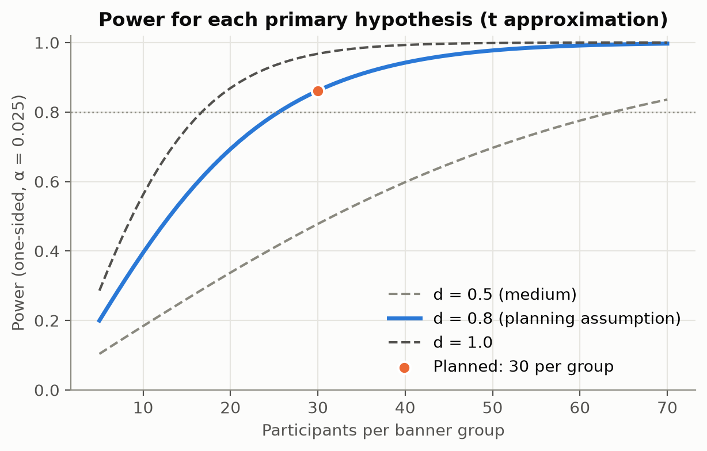
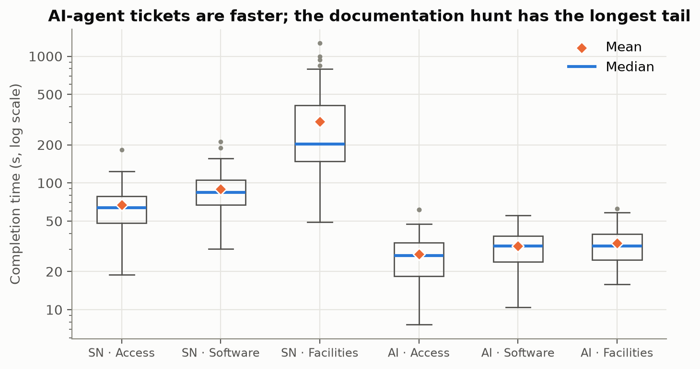
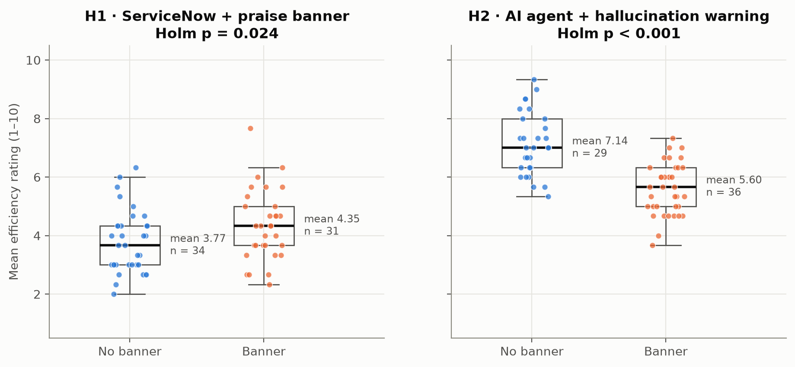
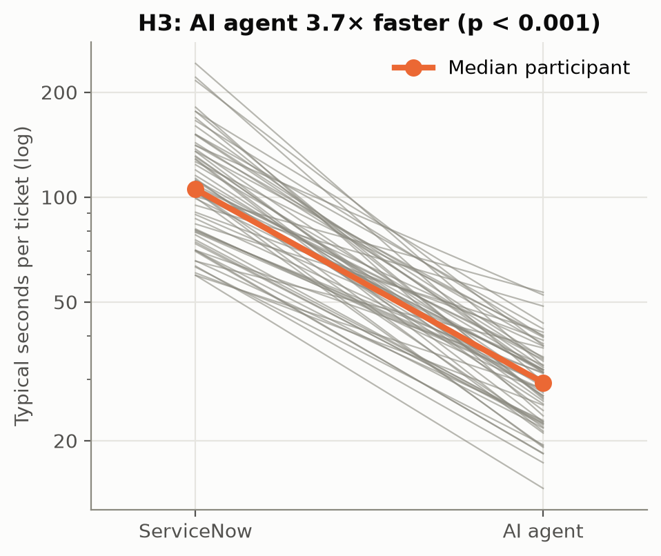
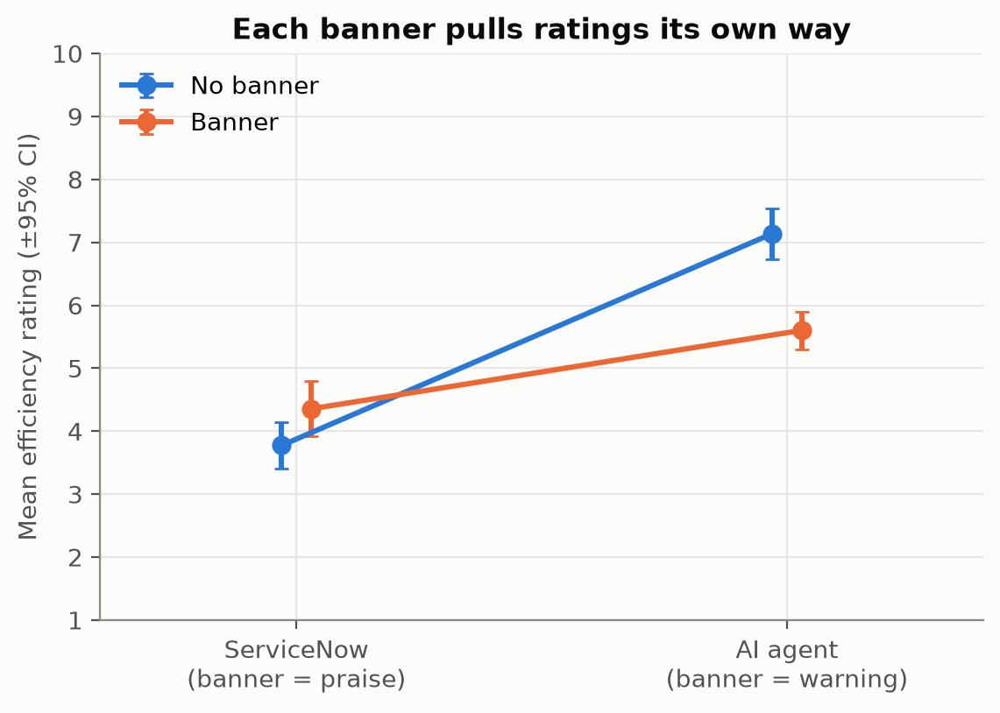
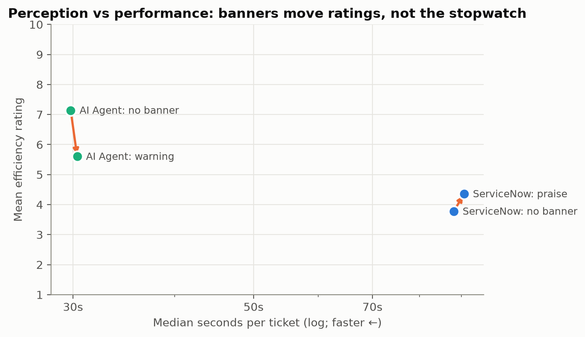

<!-- GENERATED by scripts/build_report.py from report/report_template.md. Edit the template, not this file. -->

# Praise for the Incumbent, Warnings for the AI: How One Sentence Shifts Ratings of Enterprise Ticketing Tools

**Author:** [Your name] · Module Project 2: Statistical Analysis · October 24, 2026

> ⚠️ **These results come from a SIMULATED pilot dataset** (`data/raw/simulated_pilot_raw.csv`), generated to build and test the analysis pipeline before real participants were run. They are not empirical findings. After the live session, run `python scripts/export_supabase.py` and `python scripts/run_pipeline.py --raw data/raw/live_sessions.csv` to regenerate this report.

---

## 1. Abstract

Organisations decide whether to keep legacy tools or adopt AI largely from what users *report*, and those reports are collected amid strong messaging: vendors praise incumbent platforms, and public discussion warns that AI "hallucinates". We built a ServiceNow-style service portal in which every participant filed six realistic, noisy IT tickets, three through classic catalog forms and three with an AI agent embedded in the form, and rated each one. Two independent coin flips decided whether participants saw a **positive banner** before the ServiceNow set ("ServiceNow's single pane of glass is incredibly efficient") and a **negative banner** before the AI set ("AI agents are known to hallucinate…"). With 65 analysable participants, the praise banner shifted ratings by +0.58 points (Holm p = 0.024, r = 0.29). The hallucination warning shifted ratings by -1.54 points (Holm p < 0.001, r = -0.73). Meanwhile, the AI agent was 3.7× faster per ticket (95% CI 3.4–4.0×). Framing pushed perception against performance in both directions: a slower incumbent was rated up and a faster AI was rated down. We discuss implications for how organisations evaluate and roll out AI.

## 2. Background & Motivation

IT service management (ITSM) platforms such as ServiceNow, and the AI agents now being built into them, sit between employees and almost every operational request. Purchasing, renewal and rollout decisions lean heavily on **perceived efficiency and satisfaction**: survey ratings, NPS, and "would you use it again?". Those perceptions are formed in an environment saturated with framing. Incumbent vendors market efficiency ("single pane of glass"), while AI tools arrive wrapped in warnings about hallucination and error.

Behavioural research suggests framing can shift judgments that should depend on experience. Anchoring and framing effects are well documented (Tversky & Kahneman, 1974; 1981), although some priming effects have not replicated (Doyen et al., 2012), so their size in applied settings needs testing directly. Usability research also separates **behavioural** measures (time on task, errors, abandonment) from **attitudinal** ones (ratings such as the SUS; Brooke, 1996), and the two can diverge.

This study asks whether framing pushes perception **against** performance in both directions: up for a slow incumbent, down for a fast AI. If it does, satisfaction surveys collected after vendor or media messaging would mis-rank tools, and AI programmes would be judged unfairly at exactly the moment adoption decisions are made.

## 3. Research Questions & Hypotheses

| | Null hypothesis (H₀) | Alternative (H₁) | Role |
|---|---|---|---|
| **H1** | Mean ServiceNow efficiency ratings have the same distribution with and without the praise banner. | Praise-banner participants rate ServiceNow **higher** (one-sided). | Primary |
| **H2** | Mean AI-agent efficiency ratings have the same distribution with and without the warning banner. | Warned participants rate the AI agent **lower** (one-sided). | Primary |
| **H3** | Within participants, AI-agent tickets are not faster than ServiceNow tickets. | AI-agent tickets are **faster** (one-sided). | Performance check |
| **H4** | Warned and unwarned participants override the AI agent's category at the same rate. | Warned participants override **more** (one-sided). | Secondary |
| E | — | Platform × banner interaction; who chooses the AI next time; NPS and trust; effects by job level. | Exploratory |

The directions were fixed before data collection, which justifies the one-sided tests. H1 and H2 form the primary family and are **Holm-corrected** (Holm, 1979). The exploratory analyses carry no confirmatory claims.

## 4. Experimental Design

**Instrument.** A static web app hosted on GitHub Pages (`site/`) recreates a ServiceNow-style service portal. Participants are told it is 4:45 PM on a Friday and they have six urgent requests to log. For every ticket they describe the problem **in their own words** (so the ticket text is realistic and noisy), then rate it.

| Ticket | ServiceNow set (catalog forms) | AI agent set (AI fills the form) |
|---|---|---|
| Access | Password reset: four mandatory fields | MFA reset |
| Software | Licence request: cost-centre format validation | Software install |
| Facilities | Boardroom AV: **no submit button**; the checkout code is buried in a KB article | Meeting-room camera |

In the AI set, the participant types a description and an AI agent (a naive Bayes text classifier) fills in the category, priority, assignment group and short description, showing its confidence. The participant reviews the ticket, can correct anything, and submits.

**Independent variables.**
- *Praise banner* (between subjects, 50%): shown before and during the ServiceNow set.
- *Warning banner* (between subjects, 50%, **independent** of the praise banner): shown before and during the AI set.
- *Platform* (within subjects): ServiceNow vs AI agent.
- *Set order* (randomised 50/50): ServiceNow first or AI first, to balance learning and fatigue.
- *Job level and experience* (measured, optional).

**Dependent variables.** Perceived efficiency (1–10, primary), frustration (1–10), completion time (seconds, logged automatically), errors and corrections, abandonment ("I give up" button), whether the participant kept or overrode the AI's category, and a final survey: recommend-ServiceNow (0–10, NPS), trust in the AI agent (1–10), and which tool they would rather use next time.

**Controls and randomisation.** Each banner has a no-banner control. Because the two banners are independent coin flips, every participant contributes to **both** primary comparisons, and the 2 × 2 factorial lets us check that one banner does not alter the other's effect. Allocation happens in the participant's browser with a cryptographic random number generator, so the facilitator cannot influence it. Participants are debriefed about the banners at the end.

**Ethics.** Participants consent on the start screen. No names or contact details are collected, demographics are optional, and participants are asked not to type personal information into tickets.

## 5. Power Analysis

Power analysis was done before data collection with `statsmodels.stats.power` (`scripts/power_analysis.py`).

- **Primary tests (H1, H2):** smallest effect of interest **d = 0.8** (Cohen's "large"; Cohen, 1988). This is realistic for a session-sized sample, and the sensitivity table shows the trade-off. Because Holm's first step tests at α/2, each test is planned at **one-sided α = 0.025**, with target power 0.8.
- A two-sample t-test needs **25.5 per banner group**. Dividing by Mann–Whitney's minimum asymptotic relative efficiency of 0.864 (Hodges & Lehmann, 1956) gives **30 per group (60 analysable participants)**. Every participant counts in both comparisons, so this one number serves H1 and H2.
- Allowing **10% attrition** gives a **recruitment target of 68**.
- **H3 (paired):** d_z = 1.0 needs only 7.7 pairs.

**Sensitivity** (smallest d detectable with 80% power, one-sided α = 0.025):

| Participants per banner group | Minimum detectable d |
|---|---|
| 10 | 1.32 |
| 15 | 1.06 |
| 20 | 0.91 |
| 25 | 0.81 |
| 30 | 0.74 |
| 40 | 0.63 |
| 50 | 0.57 |

**Simulation check.** Across 300 simulated studies of 60 participants under our simulation model (`lab/simulate.py`), the Holm-corrected tests rejected H1 in 78%, H2 in 99%, and both in 77% of studies. The model implies effects of d ≈ 0.67 (praise) and d ≈ 1.24 (warning). The praise effect is the harder one to detect.

*Figure 1. Power for each primary hypothesis by group size.*

## 6. Data Collection & Cleaning

**Collection.** Participants complete the study on the live site. Every rated ticket is inserted as one row in a Supabase (PostgreSQL) table, and every final survey as one row in a second table. Row-level security allows anonymous inserts and reads but no edits or deletions. `scripts/export_supabase.py` downloads both tables to `data/raw/`.

**Cleaning rules** (`scripts/clean_data.py`), fixed before outcomes were examined:

1. Remove ids listed as dry runs or withdrawals (`data/raw/excluded_ids.txt`).
2. Remove double-submitted rows (same participant and ticket), keeping the first.
3. Remove rows with impossible values (ratings outside 1–10, non-positive times, invalid flags).
4. Blank out-of-range demographics rather than dropping the participant.
5. Re-derive the design columns from the design definition, and drop anyone whose banner assignment changes between rows.
6. Exclude participants with any ticket longer than **30 minutes** (they walked away).
7. Keep only participants who completed **all six tickets**.

Long but genuine completion times under the 30-minute rule were **not** trimmed.

| Step | Rows | Participants | Note |
|---|---|---|---|
| Raw data loaded | 411 → 411 | 69 → 69 | – |
| Excluded ids removed (dry runs / withdrawals) | 411 → 405 | 69 → 68 | – |
| Double-submitted rows removed | 405 → 402 | 68 → 68 | – |
| Rows with impossible values removed | 402 → 402 | 68 → 68 | – |
| Demographics validated (blanked, not dropped) | 402 → 402 | 68 → 68 | 4 participant(s) have at least one missing/blank demographic |
| Participants with inconsistent banner assignment removed | 402 → 402 | 68 → 68 | – |
| Walk-aways removed (any ticket > 30 min) | 402 → 396 | 68 → 67 | – |
| Incomplete participants removed (< 6 tickets) | 396 → 390 | 67 → 65 | – |

**Analysable sample:** 65 participants (31 saw the praise banner; 36 saw the warning). Banner cells: praise=0, warning=0: 14; praise=0, warning=1: 20; praise=1, warning=0: 15; praise=1, warning=1: 16. 61 gave a job level, and 65 completed the final survey.

**Randomisation check.** For the praise banner, median years of experience were 4.5 vs 7 (Mann–Whitney p = 0.037), job level p = 0.589 (χ²), set order p = 1.000 (χ²). For the warning banner, median years of experience were 6 vs 6 (Mann–Whitney p = 0.754), job level p = 0.327 (χ²), set order p = 0.997 (χ²). Some expected counts are below 5 (minimum 4.0), so the χ² checks are approximate. At least one check suggests an imbalance; treat that comparison with extra caution.

## 7. Statistical Analysis

**Unit of analysis.** The participant. Each person's three ServiceNow ratings and three AI ratings are averaged, so two-sample tests compare independent people. **Software:** Python with pandas, SciPy (Virtanen et al., 2020) and statsmodels (Seabold & Perktold, 2010). The teaching site recomputes the same tests in the browser, and its implementation is checked against SciPy and statsmodels in `site/tests/`.

### 7.1 Descriptive statistics

| Ticket | n | Mean (s) | Median (s) | SD | IQR | Skew | Efficiency | Abandoned |
|---|---|---|---|---|---|---|---|---|
| SN · Access | 65 | 67.4 | 63.7 | 27.3 | 30.0 | 1.29 | 4.88 | 0% |
| SN · Software | 65 | 89.8 | 84.1 | 35.8 | 38.8 | 1.05 | 4.51 | 0% |
| SN · Facilities | 65 | 305.1 | 202.6 | 248.3 | 262.4 | 1.76 | 2.77 | 17% |
| AI · Access | 65 | 27.5 | 26.7 | 11.4 | 15.3 | 0.76 | 6.37 | 0% |
| AI · Software | 65 | 31.9 | 31.7 | 10.6 | 14.4 | 0.28 | 6.37 | 2% |
| AI · Facilities | 65 | 33.6 | 31.9 | 11.7 | 14.6 | 0.68 | 6.12 | 0% |

Every ticket's completion time is right-skewed. The most extreme is **SN · Facilities** (skew 1.8, mean 305 s vs median 203 s), so medians, geometric means and rank-based tests describe the typical participant better than arithmetic means.

*Figure 2. Completion time by ticket (log scale). Diamonds are means; blue lines are medians.*

### 7.2 H1 and H2 (primary): do the banners move ratings?

*Test choice.* The outcomes are averages of 1–10 ratings: bounded, ordinal-ish and often skewed. The pre-specified test is a **one-sided Mann–Whitney U** (Mann & Whitney, 1947), with Welch's t (Welch, 1947) as a sensitivity check. Normality was checked with Shapiro–Wilk (Shapiro & Wilk, 1965) and equal variances with Levene's test (Levene, 1960).

| | H1: ServiceNow, praise banner | H2: AI agent, warning banner |
|---|---|---|
| Banner group: n, mean (SD), median | 31, 4.35 (1.20), 4.33 | 36, 5.60 (0.88), 5.67 |
| No banner: n, mean (SD), median | 34, 3.77 (1.07), 3.67 | 29, 7.14 (1.07), 7.00 |
| Shapiro–Wilk p (banner / none) | 0.398 / 0.072 | 0.479 / 0.487 |
| Levene p | 0.758 | 0.393 |
| **Mann–Whitney U, one-sided p** | **U = 678, p = 0.024** | **U = 142, p < 0.001** |
| **Holm-adjusted p** | **0.024** | **< 0.001** |
| Rank-biserial r (95% bootstrap CI) | 0.29 [0.01, 0.54] | -0.73 [-0.87, -0.54] |
| Cohen's d (95% CI) | 0.51 [0.02, 1.01] | -1.59 [-2.15, -1.03] |
| Mean difference (Welch 95% CI) | +0.58 [0.01, 1.15] | -1.54 [-2.03, -1.04] |
| Welch t sensitivity | t(60.4) = 2.05, p = 0.022 | t(54.1) = -6.23, p < 0.001 |

**Decision, H1:** reject H₀. Participants who saw the praise banner rated ServiceNow higher (r = 0.29, mean difference +0.58 points).
**Decision, H2:** reject H₀. Participants who saw the hallucination warning rated the AI agent lower (r = -0.73, mean difference -1.54 points).

*Figure 3. Per-person mean efficiency ratings by banner. Each dot is one participant.*

### 7.3 H3 (performance check): is the AI agent actually faster?

Each participant used both platforms, so we use a **paired** test on the per-person difference in log geometric-mean time. On a log scale a multiplicative speed-up becomes an additive difference. The pre-specified test is the **one-sided Wilcoxon signed-rank test** (Wilcoxon, 1945); the paired-t interval on the log scale gives the estimate. Shapiro–Wilk on the log differences: p = 0.813.

- Median participant: 105 s per ServiceNow ticket vs 29 s per AI-agent ticket; 100% of participants were faster with the AI.
- **Wilcoxon W = 0, p < 0.001.** Speed-up **3.7×** (95% CI 3.4–4.0×); d_z = -3.74; matched-pairs rank-biserial r = -1.00.

**Decision:** reject H₀. The AI agent was genuinely faster.

*Figure 4. Each line is one participant's typical ServiceNow vs AI-agent time.*

### 7.4 H4 (secondary): does the warning make people overrule the AI?

Each participant's override rate is the share of their AI tickets where they changed the AI's category. Warned: mean 20% (n = 36); unwarned: mean 12% (n = 29). **Mann–Whitney U = 596, one-sided p = 0.131**, rank-biserial r = 0.14 [-0.10, 0.38]. At ticket level the override rates were 20% vs 12% (χ² = 2.66, p = 0.103). Tickets from the same person are not independent, so the χ² is descriptive only.

**Decision:** fail to reject H₀. The difference in override rates could be chance at this sample size.

### 7.5 Exploratory: the platform × banner interaction (two-way ANOVA, post hoc)

Each person contributes one mean rating per platform. A **linear mixed model** with a random intercept per participant, `efficiency ~ platform * banner + (1 | participant)`, is the formal test: the interaction coefficient was **-1.81 (p < 0.001)**. For comparison with the course's two-way ANOVA, the Type II ANOVA on the same data (which ignores the pairing) gives:

| Term | F | df | p | partial η² |
|---|---|---|---|---|
| Platform | 150.13 | 1 | < 0.001 | 0.54 |
| Banner | 6.49 | 1 | 0.012 | 0.05 |
| Platform × banner | 32.53 | 1 | < 0.001 | 0.21 |

*Post hoc.* Tukey's HSD (Tukey, 1949) across the four platform × banner cells found 5 of 6 pairwise differences significant at a family-wise α of 0.05 (`results/tables/interaction_tukey_hsd.csv`).

*Figure 5. Mean efficiency by platform and banner (per-person means, ±95% CI).*

### 7.6 Exploratory: choice, NPS, trust, and who is most affected

**Choosing the AI next time.** 40% would rather use the AI agent. Logistic regression `prefer_ai ~ speed-up + warned + praised` (n = 65, McFadden pseudo-R² = 0.06):

| Predictor | Odds ratio | 95% CI | p |
|---|---|---|---|
| speedup_log | 1.60 | [0.37, 6.86] | 0.528 |
| ai_primed | 0.84 | [0.29, 2.39] | 0.741 |
| snow_primed | 0.29 | [0.10, 0.84] | 0.023 |

**ServiceNow NPS.** -71 with the praise banner vs -94 without (Mann–Whitney on the 0–10 scores, one-sided p < 0.001).

**Trust in the AI agent.** Mean 6.28 when warned vs 7.93 unwarned (one-sided p = 0.001).

**By job level** (banner minus no-banner mean rating): IC: praise +0.61, warning -0.84 (n = 31); Lead: praise +0.87, warning -1.74 (n = 21); Director: praise +1.28, warning -1.89 (n = 9). Cells are small, so treat these as hypotheses for a follow-up.

*Figure 6. Perception vs performance: each arrow is what a banner did to the same system.*

## 8. Interpretation of Results

**Performance.** The AI agent was clearly faster (3.7× per ticket, 100% of people faster with it). Whatever the ratings say, the stopwatch favours the AI.

**Perception.** The praise banner shifted ratings by +0.58 points (Holm p = 0.024, r = 0.29). The hallucination warning shifted ratings by -1.54 points (Holm p < 0.001, r = -0.73). The banners moved ratings in opposite directions while measured performance was identical across banner groups, which is the core of the perception–performance gap.

**Behaviour.** Override rates did not differ reliably, so the warning changed ratings more clearly than it changed behaviour at this sample size.

**Practical significance.** Mean shifts of 0.6 (praise) and 1.5 (warning) points on a ten-point scale, from a single sentence each, are the size of difference that can flip a vendor comparison or a pilot go/no-go decision.

## 9. Limitations

- **Data.** Every number in this version comes from **simulated** participants generated by our own model (`lab/simulate.py`). It shows the pipeline works and what the report will say; it says nothing about real people. Regenerate the report from the live session export.
- **Power and effect sizes.** The study is powered for large effects (d = 0.8). The praise effect implied by our own simulation model is closer to d ≈ 0.67, so a non-significant H1 would be weak evidence of no effect.
- **Floor effects.** 45% of documentation-hunt efficiency ratings were 1 or 2, which leaves little room for a banner to act on the worst ServiceNow ticket.
- **The AI agent is simple.** A naive Bayes classifier is not a large language model, but it behaves like a real routing AI: usually right, sometimes confidently wrong, with a visible confidence score.
- **Simulation, not the workplace.** Participants were not under real deadlines and were filing tickets about scenarios they were given, using a portal that only resembles ServiceNow (no affiliation).
- **Convenience sample.** Participants were drawn from a teaching session. Job-level cells, especially directors, are small.
- **Single-item ratings and demand effects.** Single sliders are noisy, and participants who spot a banner as a manipulation may react against it.

## 10. Conclusion & Recommendations

In this simulated pilot, the AI agent was 3.7× faster, yet one sentence of framing raised ratings of the slower incumbent and lowered ratings of the faster AI. For anyone leading AI adoption, the lesson is that **user perception is an outcome you have to measure and manage, not a neutral readout of quality.** Pair every survey with behavioural metrics, run rollouts as randomised experiments, and communicate AI risks with evidence rather than slogans.

**Recommendations for implementing AI in ServiceNow.**
1. **Measure behaviour, not just opinion.** Time per ticket, completion, corrections and abandonment should sit next to every satisfaction score.
2. **Run rollouts as experiments.** Randomise who gets the AI and what they are told, and size the pilot with a power analysis first.
3. **Manage the narrative deliberately.** Warnings about AI shape ratings and overrides. Pair honest risk communication with evidence of performance, and keep evaluation surveys free of marketing.
4. **Report uncertainty.** Effect sizes with confidence intervals, and posteriors for accuracy claims, not single numbers.

## 11. References

Brooke, J. (1996). SUS: A "quick and dirty" usability scale. In P. W. Jordan, B. Thomas, B. A. Weerdmeester, & I. L. McClelland (Eds.), *Usability evaluation in industry* (pp. 189–194). Taylor & Francis.

Cohen, J. (1988). *Statistical power analysis for the behavioral sciences* (2nd ed.). Lawrence Erlbaum Associates.

Doyen, S., Klein, O., Pichon, C.-L., & Cleeremans, A. (2012). Behavioral priming: It's all in the mind, but whose mind? *PLoS ONE, 7*(1), e29081.

Hodges, J. L., & Lehmann, E. L. (1956). The efficiency of some nonparametric competitors of the t-test. *The Annals of Mathematical Statistics, 27*(2), 324–335.

Holm, S. (1979). A simple sequentially rejective multiple test procedure. *Scandinavian Journal of Statistics, 6*(2), 65–70.

Levene, H. (1960). Robust tests for equality of variances. In I. Olkin (Ed.), *Contributions to probability and statistics* (pp. 278–292). Stanford University Press.

Mann, H. B., & Whitney, D. R. (1947). On a test of whether one of two random variables is stochastically larger than the other. *The Annals of Mathematical Statistics, 18*(1), 50–60.

Seabold, S., & Perktold, J. (2010). statsmodels: Econometric and statistical modeling with Python. *Proceedings of the 9th Python in Science Conference*, 92–96.

Shapiro, S. S., & Wilk, M. B. (1965). An analysis of variance test for normality (complete samples). *Biometrika, 52*(3–4), 591–611.

Tukey, J. W. (1949). Comparing individual means in the analysis of variance. *Biometrics, 5*(2), 99–114.

Tversky, A., & Kahneman, D. (1974). Judgment under uncertainty: Heuristics and biases. *Science, 185*(4157), 1124–1131.

Tversky, A., & Kahneman, D. (1981). The framing of decisions and the psychology of choice. *Science, 211*(4481), 453–458.

Virtanen, P., Gommers, R., Oliphant, T. E., et al. (2020). SciPy 1.0: Fundamental algorithms for scientific computing in Python. *Nature Methods, 17*, 261–272.

Welch, B. L. (1947). The generalization of "Student's" problem when several different population variances are involved. *Biometrika, 34*(1–2), 28–35.

Wilcoxon, F. (1945). Individual comparisons by ranking methods. *Biometrics Bulletin, 1*(6), 80–83.

---

*Reproduce every number in this report with `python scripts/run_pipeline.py` (see README).*
