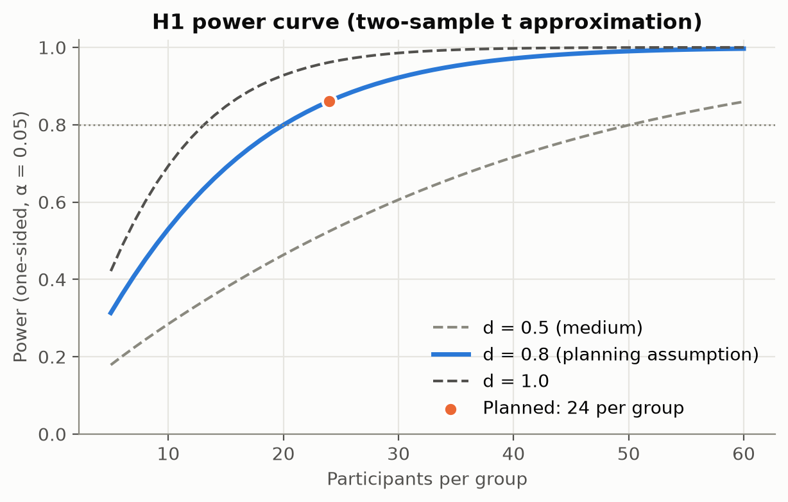
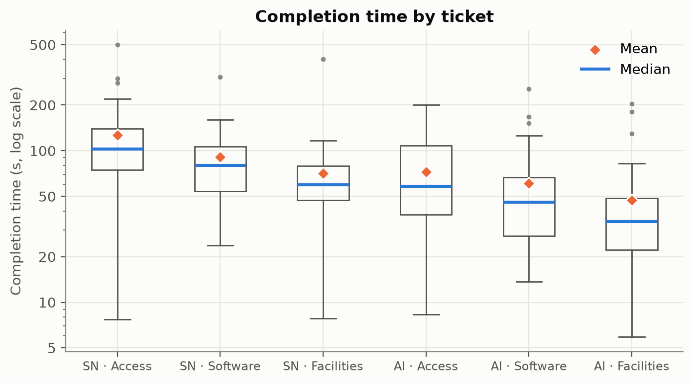
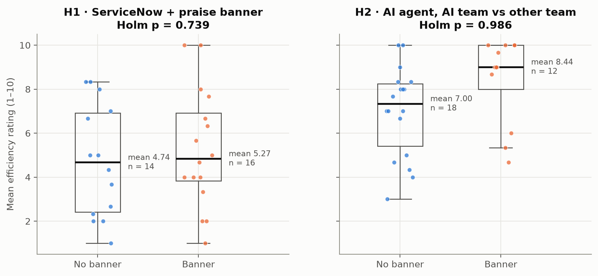
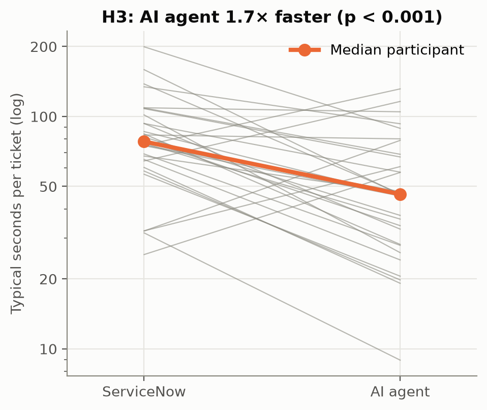
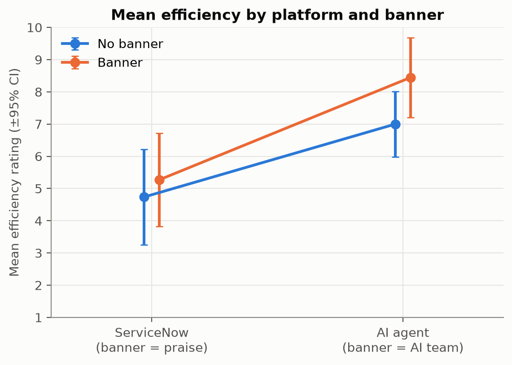
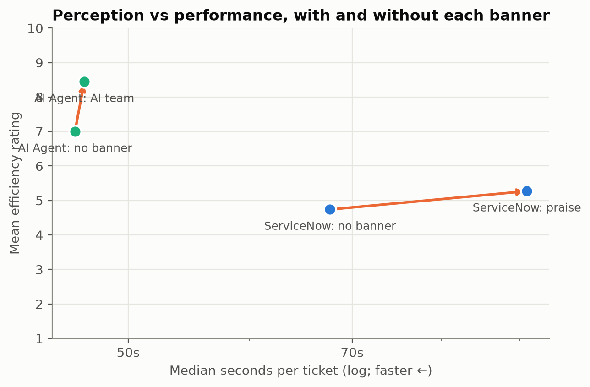

<!-- GENERATED by scripts/build_report.py from report/report_template.md. Edit the template, not this file. -->

# Praise for the Incumbent, Warnings for the AI: Does One Sentence Shift Ratings of Enterprise Ticketing Tools?

**Author:** Natalie Zachariah · Module Project 2: Statistical Analysis · November 07, 2026

> Data: real participants from one live session, collected with the study site (`data/raw/live_sessions_deidentified.csv`).

---

## 1. Abstract

Organisations decide whether to keep legacy tools or adopt AI largely from what users *report*, and those reports are collected amid strong messaging: vendors praise incumbent platforms, and public discussion warns that AI "hallucinates". We built a ServiceNow-style service portal in which every participant filed six realistic, noisy IT tickets, three through classic catalog forms and three with an AI agent embedded in the form, and rated each one. Two independent coin flips decided whether participants saw a **positive banner** before the ServiceNow set ("ServiceNow's single pane of glass is incredibly efficient") and a **negative banner** before the AI set ("AI agents are known to hallucinate…"). With 30 analysable participants, the praise banner did not detectably shift ratings in the predicted direction (mean difference +0.53 points, Holm p = 0.739). The AI-team package (warning, displayed confidence, always-correct agent) did not detectably shift ratings in the predicted direction (mean difference +1.44 points, Holm p = 0.986). Meanwhile, the AI agent was 1.7× faster per ticket (95% CI 1.3–2.2×). Participants also rated the AI agent +2.56 points on efficiency, but scenarios differed between platforms, and exclusions were uneven by which set came first. With fewer participants than planned, we treat this as a pilot.

## 2. Background & Motivation

IT service management (ITSM) platforms such as ServiceNow, and the AI agents now being built into them, sit between employees and almost every operational request. Purchasing, renewal and rollout decisions lean heavily on **perceived efficiency and satisfaction**: survey ratings, NPS, and "would you use it again?". Those perceptions are formed in an environment saturated with framing. Incumbent vendors market efficiency ("single pane of glass"), while AI tools arrive wrapped in warnings about hallucination and error.

Behavioural research suggests framing can shift judgments that should depend on experience. Anchoring and framing effects are well documented (Tversky & Kahneman, 1974; 1981), although some priming effects have not replicated (Doyen et al., 2012), so their size in applied settings needs testing directly. Usability research also separates **behavioural** measures (time on task, errors, abandonment) from **attitudinal** ones (ratings such as the SUS; Brooke, 1996), and the two can diverge.

This study asks whether framing pushes perception **against** performance in both directions: up for a slow incumbent, down for a fast AI. If it did, satisfaction surveys collected after vendor or media messaging could mis-rank tools, and AI programmes would be judged unfairly at exactly the moment adoption decisions are made.

## 3. Research Questions & Hypotheses

| | Null hypothesis (H₀) | Alternative (H₁) | Role |
|---|---|---|---|
| **H1** | Mean ServiceNow efficiency ratings have the same distribution with and without the praise banner. | Praise-banner participants rate ServiceNow **higher** (one-sided). | Primary |
| **H2** | Mean AI-agent efficiency ratings have the same distribution for the AI team and the other team. | The AI team (warned, shown confidence, always-correct agent) rates the AI agent **lower** (one-sided). | Primary |
| **H3** | Within participants, AI-agent tickets are not faster than ServiceNow tickets. | AI-agent tickets are **faster** (one-sided). | Performance check |
| **H4** | The AI team and the other team override the AI agent's category at the same rate. | The AI team overrides **more** (one-sided), even though its agent was always right. | Secondary |
| E | — | Platform × banner interaction; who chooses the AI next time; NPS and trust; effects by job level. | Exploratory |

The directions were fixed before data collection, which justifies the one-sided tests. H1 and H2 form the primary family and are **Holm-corrected** (Holm, 1979). The exploratory analyses carry no confirmatory claims.

## 4. Experimental Design

**Instrument.** A static web app hosted on GitHub Pages (`site/`) recreates a ServiceNow-style service portal. Participants are told it is 4:45 PM on a Friday and they have six urgent requests to log. For every ticket they describe the problem **in their own words** (so the ticket text is realistic and noisy), then rate it.

| Ticket | ServiceNow set (catalog forms) | AI agent set (AI fills the form) |
|---|---|---|
| Access | Password reset | MFA reset |
| Software | Licence request | Software install |
| Facilities | Boardroom AV | Meeting-room camera: for the non-AI team, the agent fills in the **wrong room and cart code** |

Every ServiceNow ticket takes the same effort: four mandatory fields, a description, and a Shopping Cart checkout whose reference code is in a KB article.

In the AI set, the participant types a description and an AI agent fills in the same four fields, the category, a short description and the cart reference. The participant reviews the ticket, can correct anything, and submits; AI tickets always submit. If the AV ticket's wrong room is not corrected, the participant then receives an angry email from the (fictional) AV Operations team before rating the ticket.

**Independent variables.**
- *Praise banner* (between subjects, 50%): shown before and during the ServiceNow set.
- *AI team* (between subjects, 50%, **independent** of the praise banner): a hallucination-warning banner before and during the AI set, the agent's confidence shown on every AI ticket, and an agent that is always right. The other team sees no banner and no confidence score, and its agent gets the AV ticket wrong. These three elements change together, so H2 and H4 test the package, not the banner alone.
- *Platform* (within subjects): ServiceNow vs AI agent.
- *Set order* (randomised 50/50): ServiceNow first or AI first, to balance learning and fatigue.
- *Job level and experience* (measured, optional).

**Dependent variables.** Perceived efficiency (1–10, primary), how frustrating the ticket was (1–10), whether a planted AI error was caught, completion time (seconds, logged automatically), errors and corrections, abandonment ("I give up" button), whether the participant kept or overrode the AI's category, and a final survey: recommend-ServiceNow (0–10, NPS), trust in the AI agent (1–10), and which tool they would rather use next time.

**Controls and randomisation.** Each banner has a no-banner control. Because the two banners are independent coin flips, every participant contributes to **both** primary comparisons, and the 2 × 2 factorial lets us check that one banner does not alter the other's effect. Allocation happens in the participant's browser with a cryptographic random number generator, so the facilitator cannot influence it. Participants are debriefed about the banners at the end.

**Ethics.** A mock IRB review (`docs/IRB_REVIEW.md`) guided the safeguards; it is a learning exercise, not a formal determination. Participants consent on the start screen, are debriefed on the deception at the end, and can withdraw their data. No names or contact details are collected, demographics are optional, and free text is neither displayed nor published.

## 5. Power Analysis

Power analysis was done before data collection with `statsmodels.stats.power` (`scripts/power_analysis.py`).

- **Primary tests (H1, H2):** smallest effect of interest **d = 0.8** (Cohen's "large"; Cohen, 1988). This is realistic for a session-sized sample, and the sensitivity table shows the trade-off. Because Holm's first step tests at α/2, each test is planned at **one-sided α = 0.025**, with target power 0.8.
- A two-sample t-test needs **25.5 per banner group**. Dividing by Mann–Whitney's minimum asymptotic relative efficiency of 0.864 (Hodges & Lehmann, 1956) gives **30 per group (60 analysable participants)**. Every participant counts in both comparisons, so this one number serves H1 and H2.
- Allowing **10% attrition** gives a **recruitment target of 68**.
- **H3 (paired):** d_z = 1.0 needs only 7.7 pairs.

**Sensitivity** (smallest d detectable with 80% power, one-sided α = 0.025):

| Participants per banner group | Minimum detectable d |
|---|---|
| 10 | 1.32 |
| 15 | 1.06 |
| 20 | 0.91 |
| 25 | 0.81 |
| 30 | 0.74 |
| 40 | 0.63 |
| 50 | 0.57 |

**Simulation check.** Across 300 simulated studies of 60 participants under our simulation model (`lab/simulate.py`), the Holm-corrected tests rejected H1 in 77%, H2 in 53%, and both in 45% of studies. The model implies effects of d ≈ 0.67 (praise) and d ≈ 0.54 (warning). The smaller warning effect is the harder one to detect.

*Figure 1. Power for each primary hypothesis by group size.*

**Achieved sample.** 30 participants were analysable, against a target of 60, so the primary tests can reliably detect only effects larger than the planned d. The banner groups were also unequal. Results are treated as a pilot, and non-significant results are not evidence of no effect. (Recruitment target: 68.)

## 6. Data Collection & Cleaning

**Collection.** Participants complete the study on the live site. Every rated ticket is inserted as one row in a Supabase (PostgreSQL) table, and every final survey as one row in a second table. With the public key, row-level security allows inserts only, and the site reads de-identified views with no free text. `scripts/export_supabase.py` writes the data to `data/raw/`; this report uses the de-identified copies, from which participants who withdrew have already been removed. The session was **pathfinders-oct28**.

**Cleaning rules** (`scripts/clean_data.py`), fixed before outcomes were examined:

1. Remove ids listed as dry runs or withdrawals (`data/raw/excluded_ids.txt`).
2. Remove double-submitted rows (same participant and ticket), keeping the first.
3. Remove rows with impossible values (ratings outside 1–10, non-positive times, invalid flags).
4. Blank out-of-range demographics rather than dropping the participant.
5. Re-derive the design columns from the design definition, and drop anyone whose banner assignment changes between rows.
6. Exclude participants with any ticket longer than **30 minutes** (they walked away).
7. Keep only participants who completed **all six tickets**.

Long but genuine completion times under the 30-minute rule were **not** trimmed.

| Step | Rows | Participants | Note |
|---|---|---|---|
| Raw data loaded | 223 → 223 | 46 → 46 | – |
| Excluded ids removed (dry runs / withdrawals) | 223 → 223 | 46 → 46 | – |
| Double-submitted rows removed | 223 → 223 | 46 → 46 | – |
| Rows with impossible values removed | 223 → 223 | 46 → 46 | – |
| Demographics validated (blanked, not dropped) | 223 → 223 | 46 → 46 | 13 participant(s) have at least one missing/blank demographic |
| Participants with inconsistent banner assignment removed | 223 → 223 | 46 → 46 | – |
| Walk-aways removed (any ticket > 30 min) | 223 → 213 | 46 → 44 | – |
| Incomplete participants removed (< 6 tickets) | 213 → 180 | 44 → 30 | – |

**Analysable sample:** 30 participants (16 saw the praise banner; 12 saw the warning). Banner cells: praise=0, warning=0: 8; praise=0, warning=1: 6; praise=1, warning=0: 10; praise=1, warning=1: 6. 23 gave a job level, and 29 completed the final survey.

**Randomisation check.** For the praise banner, median years of experience were 19 vs 13 (Mann–Whitney p = 0.775), job level p = 0.361 (χ²), set order p = 0.676 (χ²). For the warning banner, median years of experience were 18 vs 15.5 (Mann–Whitney p = 0.831), job level p = 0.595 (χ²), set order p = 1.000 (χ²). Some expected counts are below 5 (minimum 0.8), so the χ² checks are approximate. No check suggests the groups differ at baseline.

**Did people notice?** For the praise banner, 44% of those shown it said they had seen it, and 15% of those not shown it correctly said they had not (n = 29). For the AI warning, 17% of those shown it said they had seen it, and 12% of those not shown it correctly said they had not (n = 29). All analyses keep participants as randomised, so a banner that went unnoticed weakens the test of its effect.

**Who left.** 46 people started and 30 were analysable. 13 of 30 (43%) who began with the AI set were excluded, against 3 of 16 (19%) who began with ServiceNow (Fisher's exact p = 0.117). 8 of the AI-first exclusions stopped right after the AI set or after one ServiceNow ticket. Set order itself split 30 to 16 among starters (binomial p = 0.054), against an expected 50/50. These checks were added after seeing the data. Because the plan keeps completers only, people who left over the ServiceNow experience may be missing from the comparison.

## 7. Statistical Analysis

**Unit of analysis.** The participant. Each person's three ServiceNow ratings and three AI ratings are averaged, so two-sample tests compare independent people. **Software:** Python with pandas, SciPy (Virtanen et al., 2020) and statsmodels (Seabold & Perktold, 2010). The teaching site recomputes the same tests in the browser, and its implementation is checked against SciPy and statsmodels in `site/tests/`.

### 7.1 Descriptive statistics

| Ticket | n | Mean (s) | Median (s) | SD | IQR | Skew | Efficiency | Abandoned |
|---|---|---|---|---|---|---|---|---|
| SN · Access | 30 | 126.6 | 102.4 | 94.4 | 65.2 | 2.48 | 4.8 | 30% |
| SN · Software | 30 | 90.9 | 80.2 | 56.6 | 52.1 | 1.97 | 4.67 | 40% |
| SN · Facilities | 30 | 70.9 | 59.7 | 66.8 | 32.0 | 4.35 | 5.6 | 37% |
| AI · Access | 30 | 72.6 | 58.2 | 48.2 | 70.4 | 0.97 | 8.03 | 3% |
| AI · Software | 30 | 61.1 | 45.8 | 54.1 | 39.4 | 2.11 | 7.97 | 0% |
| AI · Facilities | 30 | 47.2 | 34.0 | 46.0 | 26.5 | 2.47 | 6.73 | 3% |

Every ticket's completion time is right-skewed. The most extreme is **SN · Facilities** (skew 4.4, mean 71 s vs median 60 s), so medians, geometric means and rank-based tests describe the typical participant better than arithmetic means.

*Figure 2. Completion time by ticket (log scale). Diamonds are means; blue lines are medians.*

### 7.2 H1 and H2 (primary): do the banners move ratings?

*Test choice.* The outcomes are averages of 1–10 ratings: bounded, ordinal-ish and often skewed. The pre-specified test is a **one-sided Mann–Whitney U** (Mann & Whitney, 1947), with Welch's t (Welch, 1947) as a sensitivity check. Normality was checked with Shapiro–Wilk (Shapiro & Wilk, 1965) and equal variances with Levene's test (Levene, 1960).

| | H1: ServiceNow, praise banner | H2: AI agent, AI team |
|---|---|---|
| Banner / AI team: n, mean (SD), median | 16, 5.27 (2.71), 4.83 | 12, 8.44 (1.96), 9.00 |
| No banner / other team: n, mean (SD), median | 14, 4.74 (2.57), 4.67 | 18, 7.00 (2.04), 7.33 |
| Shapiro–Wilk p (banner / none) | 0.639 / 0.208 | 0.004 / 0.261 |
| Levene p | 0.969 | 0.612 |
| **Mann–Whitney U, one-sided p** | **U = 120, p = 0.369** | **U = 159, p = 0.986** |
| **Holm-adjusted p** | **0.739** | **0.986** |
| Rank-biserial r (95% bootstrap CI) | 0.08 [-0.34, 0.49] | 0.47 [0.05, 0.83] |
| Cohen's d (95% CI) | 0.20 [-0.52, 0.92] | 0.72 [-0.03, 1.47] |
| Mean difference (Welch 95% CI) | +0.53 [-1.44, 2.51] | +1.44 [-0.08, 2.97] |
| Welch t sensitivity | t(27.8) = 0.55, p = 0.292 | t(24.4) = 1.95, p = 0.969 |

**Decision, H1:** fail to reject H₀ after Holm correction. The data are compatible with effects from r = -0.34 to 0.49.
**Decision, H2:** fail to reject H₀ after Holm correction. The data are compatible with effects from r = 0.05 to 0.83. The AI team's ratings were higher, the opposite of the prediction (two-sided, unadjusted and post hoc: p = 0.031). That team also had an always-correct agent while the other team's agent made a planted error, so this gap cannot be credited to the warning, and the accuracy difference is a likely explanation.

*Figure 3. Per-person mean efficiency ratings by banner. Each dot is one participant.*

**Sensitivity to dropout** (post hoc). Keeping everyone with at least one ticket on the platform, apart from walk-aways: H1 5.14 (n = 17) vs 4.49 (n = 19), Holm p = 0.556; H2 7.55 (n = 20) vs 6.83 (n = 21), Holm p = 0.927; H3 1.7× faster across 33 people with both platforms (p < 0.001).

### 7.3 H3 (performance check): is the AI agent actually faster?

Each participant used both platforms, so we use a **paired** test on the per-person difference in log geometric-mean time. On a log scale a multiplicative speed-up becomes an additive difference. The pre-specified test is the **one-sided Wilcoxon signed-rank test** (Wilcoxon, 1945); the paired-t interval on the log scale gives the estimate. Shapiro–Wilk on the log differences: p = 0.004.

- Median participant: 78 s per ServiceNow ticket vs 46 s per AI-agent ticket; 83% of participants were faster with the AI.
- **Wilcoxon W = 70, p < 0.001.** Speed-up **1.7×** (95% CI 1.3–2.2×); d_z = -0.80; matched-pairs rank-biserial r = -0.70.

**Decision:** reject H₀. AI-agent tickets were faster, though each platform had different scenarios (section 9).

*Figure 4. Each line is one participant's typical ServiceNow vs AI-agent time.*

### 7.4 H4 (secondary): does the warning make people overrule the AI?

Each participant's override rate is the share of their AI tickets where they changed the AI's category. Warned: mean 14% (n = 12); unwarned: mean 2% (n = 18). **Mann–Whitney U = 138, one-sided p = 0.025**, rank-biserial r = 0.28 [0.00, 0.58]. At ticket level the override rates were 15% vs 2% (χ² = 5.43, p = 0.020). Tickets from the same person are not independent, so the χ² is descriptive only.

**Decision:** reject H₀. The AI team overrode the agent more often, even though its agent was always right. This rests on few overrides (ticket-level rates 15% vs 2%), the test is uncorrected and secondary, and the teams differ in more than the warning, so treat it as a lead for follow-up.

### 7.5 Exploratory: the platform × banner interaction (two-way ANOVA, post hoc)

Each person contributes one mean rating per platform. A **linear mixed model** with a random intercept per participant, `efficiency ~ platform * banner + (1 | participant)`, is the formal test: the interaction coefficient was **+0.79 (p = 0.517)**. For comparison with the course's two-way ANOVA, the Type II ANOVA on the same data (which ignores the pairing) gives:

| Term | F | df | p | partial η² |
|---|---|---|---|---|
| Platform | 19.30 | 1 | < 0.001 | 0.26 |
| Banner | 2.56 | 1 | 0.115 | 0.04 |
| Platform × banner | 0.55 | 1 | 0.460 | 0.01 |

*Post hoc.* Tukey's HSD (Tukey, 1949) across the four platform × banner cells found 3 of 6 pairwise differences significant at a family-wise α of 0.05 (`results/tables/interaction_tukey_hsd.csv`).

*Figure 5. Mean efficiency by platform and banner (per-person means, ±95% CI).*

### 7.6 Exploratory: choice, NPS, trust, and who is most affected

**Ratings by platform.** Within people, the AI agent was rated +2.56 points on efficiency (95% CI [1.47, 3.64], d_z = 0.88, Wilcoxon p < 0.001) and -2.94 on frustration (95% CI [-4.11, -1.78], d_z = -0.94, p < 0.001). 32 of 90 ServiceNow tickets were abandoned, against 2 of 90 AI tickets. Each platform always had the same scenarios, so these gaps cannot be separated from differences between the scenarios.

**The planted AI error.** 5 of the 18 participants whose agent filled in the wrong room and cart code caught it before submitting. It appeared only for the other team, so this rate has no comparison group.

**Choosing the AI next time.** 72% would rather use the AI agent. Logistic regression `prefer_ai ~ speed-up + warned + praised` (n = 29, McFadden pseudo-R² = 0.18):

| Predictor | Odds ratio | 95% CI | p |
|---|---|---|---|
| speedup_log | 4.66 | [0.84, 25.75] | 0.078 |
| ai_primed | 1.36 | [0.22, 8.54] | 0.743 |
| snow_primed | 1.47 | [0.20, 10.77] | 0.702 |

**ServiceNow NPS.** -56 with the praise banner vs -54 without (Mann–Whitney on the 0–10 scores, one-sided p = 0.254).

**Trust in the AI agent.** Mean 7.50 when warned vs 7.06 unwarned (one-sided p = 0.545).

**By job level** (banner minus no-banner mean rating): IC: praise +1.60, AI team +1.97 (n = 13). Levels with fewer than 5 people on either side of a split are not reported. Treat these as hypotheses for a follow-up.

*Figure 6. Perception vs performance: each arrow runs from the no-banner group to the banner group on the same platform.*

## 8. Interpretation of Results

**Performance.** The AI agent was clearly faster (1.7× per ticket, 83% of people faster with it). Participants also rated it more efficient and less frustrating, but the scenarios differ between platforms, so neither gap is purely about the tool.

**Perception.** The praise banner did not detectably shift ratings in the predicted direction (mean difference +0.53 points, Holm p = 0.739). The AI-team package did not detectably shift ratings in the predicted direction (mean difference +1.44 points, Holm p = 0.986). The AI team's ratings were higher, the opposite of the prediction (two-sided, unadjusted and post hoc: p = 0.031). That team also had an always-correct agent while the other team's agent made a planted error, so this gap cannot be credited to the warning, and the accuracy difference is a likely explanation. A non-significant result in a sample this size does not show the absence of an effect.

**Behaviour.** The AI team overrode the agent more often, which is a lead for follow-up rather than a firm finding, because overrides were few and the teams differ in more than the warning.

**Selection.** 13 of 30 AI-first starters were excluded, against 3 of 16 ServiceNow-first starters. If people tended to leave when they reached ServiceNow, the platform gap above is more likely understated than overstated.

**Practical significance.** The confidence intervals on the mean differences are [-1.44, 2.51] (praise) and [-0.08, 2.97] (AI team) points on a ten-point scale. These are wide: this sample can neither confirm nor rule out a banner effect large enough to matter in a vendor comparison or pilot decision.

## 9. Limitations

- **Data.** The data come from real participants in one teaching session: a small convenience sample.
- **Power and effect sizes.** The study was planned for large effects (d = 0.8) and fell short of its target sample. The praise effect implied by our own simulation model is closer to d ≈ 0.67, so a non-significant H1 is weak evidence of no effect.
- **Abandoned tickets cut the clock short.** Completion time stops when someone gives up, and far more ServiceNow tickets were abandoned, so the measured speed-up is probably an underestimate.
- **Scenarios are confounded with platform.** Each platform always had the same three scenarios, so speed and rating gaps between platforms may partly reflect easier scenarios.
- **Uneven dropout.** Keeping completers only can bias platform comparisons if people leave because of one platform. See section 6 and the sensitivity check in section 7.2.
- **Noticing.** Many participants did not report seeing the messages, which weakens both banner tests.
- **No external pre-registration.** Hypotheses and cleaning rules were fixed in this repository before the session, but were not filed with an outside registry. Analyses marked post hoc were added after seeing the data.
- **The AI-team manipulation is a package.** The warning, the displayed confidence and the agent's accuracy all differ between the AI teams, so any difference cannot be attributed to the warning alone. The planted error also lowers the other team's AI ratings, which works against H2.
- **The AI agent is simple.** A naive Bayes classifier is not a large language model, but it behaves like a real routing AI: usually right, sometimes confidently wrong, with a visible confidence score.
- **Simulation, not the workplace.** Participants were not under real deadlines and were filing tickets about scenarios they were given, using a portal that only resembles ServiceNow (no affiliation).
- **Convenience sample.** Participants were drawn from a teaching session. Job-level cells, especially directors, are small.
- **Single-item ratings and demand effects.** Single sliders are noisy, and participants who spot a banner as a manipulation may react against it.

## 10. Conclusion & Recommendations

In this experiment, the AI agent was 1.7× faster, and this pilot did not show that one sentence of framing changes ratings, though it was too small to rule that out. **The main evidence here is about the tools, not the framing:** the AI-assisted flow was faster, rated better and rarely abandoned, subject to the scenario confound and uneven dropout. A properly powered follow-up should separate the warning, the displayed confidence and the agent's accuracy, and counterbalance scenarios across platforms (`docs/IRB_REVIEW.md`, section 6).

**Recommendations for implementing AI in ServiceNow.**
1. **Measure behaviour, not just opinion.** Time per ticket, completion, corrections and abandonment should sit next to every satisfaction score.
2. **Run rollouts as experiments.** Randomise who gets the AI and what they are told, and size the pilot with a power analysis first.
3. **Test messaging rather than assuming its effect.** This pilot could not confirm or rule out framing effects, so keep evaluation surveys free of marketing and check messaging with a randomised comparison before relying on it.
4. **Report uncertainty.** Effect sizes with confidence intervals, and posteriors for accuracy claims, not single numbers.

## 11. References

Brooke, J. (1996). SUS: A "quick and dirty" usability scale. In P. W. Jordan, B. Thomas, B. A. Weerdmeester, & I. L. McClelland (Eds.), *Usability evaluation in industry* (pp. 189–194). Taylor & Francis.

Cohen, J. (1988). *Statistical power analysis for the behavioral sciences* (2nd ed.). Lawrence Erlbaum Associates.

Doyen, S., Klein, O., Pichon, C.-L., & Cleeremans, A. (2012). Behavioral priming: It's all in the mind, but whose mind? *PLoS ONE, 7*(1), e29081.

Hodges, J. L., & Lehmann, E. L. (1956). The efficiency of some nonparametric competitors of the t-test. *The Annals of Mathematical Statistics, 27*(2), 324–335.

Holm, S. (1979). A simple sequentially rejective multiple test procedure. *Scandinavian Journal of Statistics, 6*(2), 65–70.

Levene, H. (1960). Robust tests for equality of variances. In I. Olkin (Ed.), *Contributions to probability and statistics* (pp. 278–292). Stanford University Press.

Mann, H. B., & Whitney, D. R. (1947). On a test of whether one of two random variables is stochastically larger than the other. *The Annals of Mathematical Statistics, 18*(1), 50–60.

Seabold, S., & Perktold, J. (2010). statsmodels: Econometric and statistical modeling with Python. *Proceedings of the 9th Python in Science Conference*, 92–96.

Shapiro, S. S., & Wilk, M. B. (1965). An analysis of variance test for normality (complete samples). *Biometrika, 52*(3–4), 591–611.

Tukey, J. W. (1949). Comparing individual means in the analysis of variance. *Biometrics, 5*(2), 99–114.

Tversky, A., & Kahneman, D. (1974). Judgment under uncertainty: Heuristics and biases. *Science, 185*(4157), 1124–1131.

Tversky, A., & Kahneman, D. (1981). The framing of decisions and the psychology of choice. *Science, 211*(4481), 453–458.

Virtanen, P., Gommers, R., Oliphant, T. E., et al. (2020). SciPy 1.0: Fundamental algorithms for scientific computing in Python. *Nature Methods, 17*, 261–272.

Welch, B. L. (1947). The generalization of "Student's" problem when several different population variances are involved. *Biometrika, 34*(1–2), 28–35.

Wilcoxon, F. (1945). Individual comparisons by ranking methods. *Biometrics Bulletin, 1*(6), 80–83.

---

*Reproduce every number in this report with `python scripts/run_pipeline.py --raw data/raw/live_sessions_deidentified.csv` (see README).*
